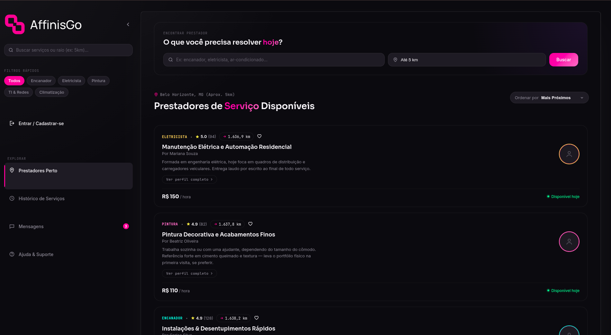

# AffinisGo Front-end

Protótipo funcional em HTML/CSS/JS (sem build step) para a plataforma que conecta clientes a prestadores de serviço por proximidade.

Sobre a construção deste projeto:

Minha companheira, além de programadora, também trabalha como tatuadora E frequêntemente reclamava de clientes que chegavam, perguntavam apenas "quanto?" ou simplesmente falavam o que queriam, como queriam e onde, e depois sumiam pensando nisso, pensei em facilitar o primeiro contato e poupar o tempo do cliente e prestador conectando clientes e prestadores de serviços locais,automatizando o primeiro contato tornando mais organizado e evitando aquela troca de mensagens cheia de perguntas e respostas o nome vem do latim Affinis, que significa vizinho, Já que o intuito é ligar usuários com prestadores próximos.



Funcionamento:

O prestador pode definir algumas perguntas que considera importantes para receber um orçamento (essas perguntas são opcionais e podem variar de acordo com o tipo de serviço), quando o cliente encontra um prestador, ao invés de simplesmente perguntar "quanto?", ele pode preencher essas informações e abrir um chamado. Nesse chamado, o prestador consegue analisar:

As respostas fornecidas pelo cliente
Informações sobre o serviço desejado
Anexos, como fotos e referências
Outros detalhes necessários para avaliar o pedido

Depois disso, o prestador decide se quer aceitar ou recusar o chamado caso aceite, um chat é aberto entre as duas partes, permitindo que elas continuem a conversa diretamente pela plataforma a ideia é melhorar a qualidade do primeiro contato, dando ao prestador informações suficientes para decidir se aquele pedido faz sentido e ao cliente uma forma mais organizada de explicar o que precisa

Front-end:

Aqui tive um auxílio construí a base com apoio da I.A Claude (modelos e dados inventados para o js e testes) Em cima de um protótipo anterior que eu mesmo desenhei. Mas não foi só trabalho da IA revisei, testei e coloquei a mão na massa de acordo com a necessidade, o alinhamento do container principal, a posição do controle de ordenação, entre outros detalhes de interface e funcionalidade o intuito é focar em trabalhar na integração entre frontend, backend e banco de dados, também na segurança e funcionalidade.

Back-end:

O back-end, por outro lado, é 100% feito e suado por mim, sem IA é onde estou colocando em prática (e apanhando um pouco) tudo que venho aprendendo em Python e banco de dados.

Tecnologias:

Python
HTML
CSS
JavaScript

Como abrir:

Não precisa de instalação. basta abrir index.html no navegador, ou servir a pasta com qualquer servidor estático

```bash
python -m http.server 8000
# depois acesse http://localhost:8000
```

Estrutura:

```
affinisgo-frontend/
├── index.html           tela principal (Prestadores Perto)
├── pages/
│   ├── login.html       entrar / cadastrar-se
│   ├── historico.html   histórico de serviços
│   ├── mensagens.html   caixa de mensagens
│   └── ajuda.html       ajuda & suporte
├── css/
│   └── styles.css       design tokens + todos os estilos
├── js/
│   ├── core.js          dados mock + funções (formatação, distância, filtro/ordenação) sem DOM, testável direto no Node
│   ├── api.js           ponto único de integração (fetchProviders, fetchMessages, fetchUnreadMessageCount, getUserCoordinates); troque USE_MOCK_DATA para false quando o backend estiver no ar
│   └── app.js           só DOM: renderização, eventos, filtros de tela
├── tests/
│   ├── core.test.js     testes unitários das funções de core.js
│   └── smoke.test.js    sobe um servidor estático local e carrega as 5 páginas reais num DOM simulado, checando que renderizam sem erro
└── assets/
    ├── images/
    │   └── Captura-de-tela-AffinisGo.png   captura da tela inicial
    ├── avatars/         pasta pronta para as fotos reais dos prestadores
    ├── favicon.svg      ícone da aba do navegador (mesmo desenho do logo-mark.svg)
    ├── logo.svg         logo completa (ícone + nome), usada na barra lateral
    └── logo-mark.svg    só o ícone, usado quando a barra lateral está recolhida
```

Rodar os testes (só na primeira vez, precisa do Node instalado):

```bash
npm install
npm test
```

Sistema de design:

Paleta: fundo escuro sólido (#0b0b0f) com gradiente de superior esquerdo para o inferior direito (grad brush), que escurece ainda mais e ganha um brilho radial sutil no :hover.

Logo: SVG (assets/logo.svg), ícone rosa #ff0099 com o nome em branco; no menu recolhido aparece só o ícone (assets/logo-mark.svg). O fundo do site vem da variável --bg em css/styles.css.

Tipografia: fraunces (serifada, itálica) AffinisGo : Sora nos títulos: Inter no corpo de texto cinza; JetBrains Mono nas etiquetas/categorias/badges de distância uma

Inspiração: a densidade de informação e a confiança visual de listas de corridas da Uber e o cruzamento (tons escuros sólidos, gradqções vívidos com tipografia em primeiro plano) do site pessoal do Zeno Rocha (criador do Dracula Theme) daí a paleta violeta/ciano e o uso de uma fonte mono.

Animações: entrada em cascata dos cartões ao carregar a página, leve elevação, brilho no hover dos cartões, micro-bounce nos ícones da barra lateral, chips de busca com "pop" ao serem criados. Tudo respeita prefers-reduced-motion.

Ligando ao backend em Python (notas para mim):

Os prestadores exibidos hoje vêm de MOCK_PROVIDERS em js/core.js, no mesmo formato que uma API deveria devolver. js/api.js já centraliza toda a integração: quando o backend Flask existir, troco USE_MOCK_DATA para false em js/api.js e fetchProviders() passa a bater direto em /api/prestadores. O mesmo vale para as mensagens (/api/mensagens) e a contagem do badge (/api/mensagens/nao-lidas). A distância de cada prestador até o usuário já é recalculada no navegador via geolocalização (Haversine); o backend só precisa devolver lat/lng de cada prestador.

Próximos passos:

Extrair a barra lateral para um partial reutilizável quando o backend Flask entrar (hoje ela está duplicada em cada página HTML por não haver templating no front puro — o ideal é virar um  do Jinja).
Trocar USE_MOCK_DATA por false em js/api.js e apontar para os endpoints reais.
Adicionar estado de loading/skeleton nos cartões enquanto a API responde (o skeleton já existe para a latência simulada do mock).
